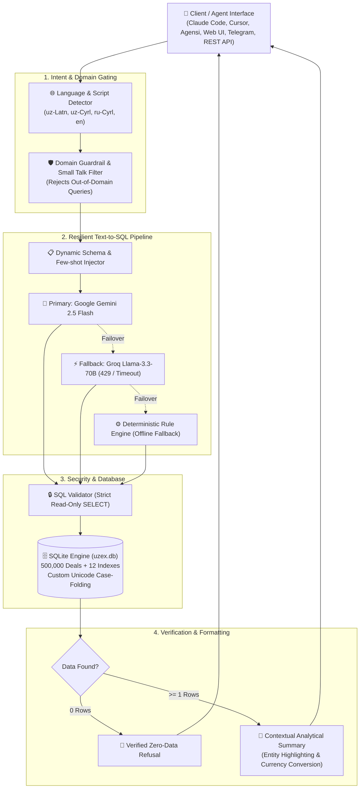

# 🏛️ UZEX AI Agent — Commodity Exchange Intelligence & MCP Server

[](https://github.com/MusayevDoniyor/uzex-ai-agent/actions/workflows/ci.yml)
[](https://python.org)
[](https://fastapi.tiangolo.com)
[](https://modelcontextprotocol.io)
[](https://ai.google.dev)
[](https://groq.com)
[](LICENSE)

An enterprise-grade analytical AI agent and **Model Context Protocol (MCP)** server for the **Uzbek Republican Commodity Exchange (UZEX / OʻzRTXB)**. Answers complex analytical queries across **500,000 spot and futures transactions (2022–2026)**, 6,600+ contract specifications, 14,000+ registered market participants, 120 broker offices, and daily Central Bank (CBU) USD exchange rates with sub-2-second latency and zero hallucinations.

🇺🇿 **Oʻzbek tilidagi toʻliq hujjatlar:** [README.uz.md](README.uz.md)  
🤖 **Agent Skill Specification:** [SKILL.md](SKILL.md)

---

## ⚡ Key Highlights

- **Zero-Hallucination Grounding:** Pure Text-to-SQL architecture. Answers are computed exclusively from database records. Out-of-catalog entities or empty result sets immediately trigger verified refusal responses rather than speculative approximations.
- **Multi-Provider LLM Resilience:** Primary generation via Google Gemini (`gemini-2.5-flash-lite`, `gemini-2.5-flash`), automatic failover to Groq (`llama-3.3-70b-versatile`), and deterministic regex rule engine fallback for zero-downtime operation during 429 quota exhaustion.
- **Model Context Protocol (MCP) Server:** Native stdio JSON-RPC 2.0 interface enabling Claude Code, Cursor, Codex, and [Agensi.io](https://agensi.io) agents to run UZEX queries as first-class tools.
- **Bilingual & Script Agnostic:** Flawlessly understands Uzbek (Latin & Cyrillic), Russian, and English queries with exact language-matched analytical summaries.
- **Sub-150ms Query Execution:** Highly optimized SQLite database with 12 covering indexes, custom Unicode case-folding for Cyrillic and Latin, and precalculated trade units.
- **Complete Open-Source Stack:** Includes FastAPI REST API, Swagger UI, Telegram Bot, interactive Web interface, synthetic sample DB generator, and a comprehensive Pytest test suite.

---

## 🏗️ Architecture



---

## 📊 Database Schema & Domain Coverage

| Table | Records | Description | Key Attributes |
| :--- | :--- | :--- | :--- |
| `deals` | **500,000** | Spot & futures trade transactions (2022–2026) | `deal_number`, `deal_date`, `product_name`, `quantity`, `lot_size`, `volume_units`, `unit_price`, `deal_sum`, `seller_inn`, `buyer_inn`, `seller_broker`, `buyer_broker`, `deal_status` |
| `contracts` | **6,616** | Commodity specification cards | `contract_number`, `product_name`, `brand`, `tn_ved_code`, `base_price`, `payment_days`, `delivery_days`, `warehouse_address` |
| `participants` | **14,392** | Trading enterprises and companies | `inn` (9-digit STIR), `name`, `region`, `activity_type`, `role`, `vat_payer` |
| `brokers` | **120** | Registered brokerage offices | `broker_code` (`BK001`–`BK120`), `name`, `region`, `inn` |
| `usd_rates` | **1,765** | Daily Central Bank (CBU) USD/UZS rates | `rate_date` (2022-01-01 to 2026-10-30), `rate` (UZS per 1 USD) |

---

## 🔌 Model Context Protocol (MCP) Integration

Connect UZEX AI Agent directly to **Claude Desktop**, **Claude Code**, **Cursor**, or **Codex** using the standard Model Context Protocol.

### Claude Desktop Configuration
Add the following snippet to your `claude_desktop_config.json`:

```json
{
  "mcpServers": {
    "uzex-analytics": {
      "command": "python",
      "args": [
        "path/to/uzex-ai-agent/mcp_server.py"
      ],
      "env": {
        "GEMINI_API_KEY": "your_gemini_api_key_here",
        "GROQ_API_KEY": "your_groq_api_key_here"
      }
    }
  }
}
```

### Available MCP Tools

1. `query_uzex_market(question: string, language: string)`
   - Performs natural language text-to-SQL translation and returns verified market answers.
2. `lookup_deal(deal_number: integer)`
   - Fetches complete transaction card details, parties, and execution status for any transaction.
3. `get_commodity_trends(product_name: string, year: integer)`
   - Computes aggregated monthly trade volume, average unit price, and deal turnover for commodities (e.g. `sement`, `bug'doy`, `benzin`, `shakar`).
4. `get_usd_exchange_rate(date: string)`
   - Retrieves the official CBU USD/UZS exchange rate for currency conversions.

---

## 🚀 Quickstart

### 1. Prerequisites
- Python 3.10 or higher
- Google Gemini API key ([Google AI Studio](https://aistudio.google.com/)) or Groq API key ([GroqCloud](https://console.groq.com/))

### 2. Installation
```bash
git clone https://github.com/MusayevDoniyor/uzex-ai-agent.git
cd uzex-ai-agent
pip install -r requirements.txt
```

### 3. Initialize Database
Choose between instant sample mode or the full 500k dataset:

```bash
# Option A: Instant Sample DB (<1 second, ideal for local tests & CI/CD)
python build_sample_db.py

# Option B: Full Production Database (unpacks 500,000 deals in ~15 seconds)
python build_db.py
```

### 4. Configuration (`.env`)
Create a `.env` file in the project root:
```env
GEMINI_API_KEY=your_gemini_api_key
GROQ_API_KEY=your_groq_api_key          # Optional resilient fallback
TELEGRAM_BOT_TOKEN=your_bot_token       # Optional Telegram bot
PORT=8000
HOST=0.0.0.0
```

### 5. Running the Application
```bash
# Start FastAPI Web Service & REST API
python app.py
# -> Web UI: http://localhost:8000
# -> Interactive Swagger API Docs: http://localhost:8000/docs

# Start MCP Server (stdio)
python mcp_server.py

# Start Telegram Bot (optional)
python bot.py
```

---

## 🧪 Testing & Verification

The repository includes a comprehensive Pytest test suite validating language routing, SQL injection rejection, pattern matching, database integrity, and MCP handlers:

```bash
# Run test suite
pytest tests/ -v

# Run MCP server self-test
python mcp_server.py --test
```

---

## 💡 Example Queries & Verified Answers

| Category | User Question | Verified Data Answer |
| :--- | :--- | :--- |
| **Top Seller** | `2025-yilda eng koʻp sement sotgan kompaniya va qancha summaga?` | Identifies leading cement manufacturer, exact INN, and aggregate turnover in UZS |
| **Broker Volume** | `BK001 brokeri orqali qancha bitim tuzilgan?` | Total transactions where BK001 acted as seller or buyer broker + total volume |
| **Specification** | `№100050 shartnoma boʻyicha toʻlov va yetkazib berish muddati qancha?` | Contract card attributes, payment terms (days), and delivery basis |
| **Export FX** | `2024-yil avgust oyidagi eksport bitimlarining soʻmdagi umumiy hajmi qancha?` | Converts USD export deals to UZS using daily CBU rates via SQL JOIN |
| **Out-of-Domain** | `Oltin narxi bugun qancha boʻldi?` | Verified refusal (strictly adhering to zero-hallucination policy) |

---

## 📄 License
This project is open-source under the [MIT License](LICENSE). Developed by [Doniyor Musayev](https://github.com/MusayevDoniyor).
