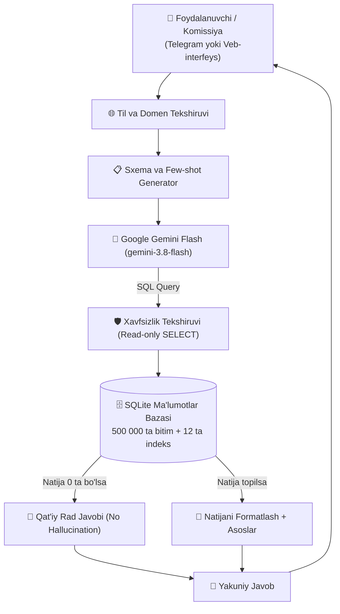

# 🏛️ UZEX AI Agent — OʻzRTXB Birja Bitimlari Tahlili

**UZEX AI Hackathon 2026** saralash bosqichi uchun ishlab chiqilgan tahliliy AI-agent.
Tizim Oʻzbekiston respublika tovar-xom ashyo birjasining 2022–2026 yillardagi **500 000 ta birja bitimi**, shartnoma kartochkalari, savdo ishtirokchilari, brokerlar va kunlik AQSh dollari kurslari asosida ishlaydi.

🌐 **GitHub:** [https://github.com/MusayevDoniyor/uzex-ai-agent](https://github.com/MusayevDoniyor/uzex-ai-agent)

---

## ⚡ Asosiy Imkoniyatlar

1. **Aniq va faktlarga asoslangan (Zero Hallucination Guarantee):**
   - Agent javoblarni faqatgina SQL orqali maʼlumotlar bazasidan olingan haqiqiy yozuvlar asosida shakllantiradi.
   - Agar soʻralgan maʼlumot bazada mavjud boʻlmasa (masalan, roʻyxatda yoʻq tovar yoki korxona), agent qatʼiy ravishda:
     - 🇺🇿 *"Taqdim etilgan birja maʼlumotlarida bu soʻrov boʻyicha maʼlumot topilmadi."*
     - 🇷🇺 *"В предоставленных биржевых данных информация по данному запросу отсутствует."*
     deb javob qaytaradi va hech qachon raqam toʻqimaydi.

2. **Ikki tilli (Bilingual RU + UZ):**
   - Oʻzbek va rus tillaridagi savollarni tabiiy tushunadi va savol berilgan tilda mukammal javob beradi.

3. **Yuqori tezlik (High Performance):**
   - 500 000 ta qatordan iborat bazada murakkab agregatsiya va JOIN soʻrovlari **80–120 millisekundda** bajariladi.
   - Umumiy javob qaytish vaqti: **1–3 soniya** (komissiya talabidagi 90 soniyadan ancha tez).

4. **Shaffoflik va asoslanganlik (Data Provenance):**
   - Har bir javob tagida bajarilgan aniq SQL soʻrov va sarflangan vaqt koʻrsatiladi.

---

## 🏗️ Tizim Arxitekturasi



---

## 📊 Maʼlumotlar Bazasi Tuzilishi

* `deals`: 500 000 ta bitim (2022–2026 yillar). Maydonlar: raqam, sana, vaqt, auksion turi, hajm, summa, narx, shartnoma, tovar, oʻlchov birligi, viloyat, holat, sotuvchi/xaridor STIR, brokerlar, toʻlov/yetkazish sanalari.
* `contracts`: 6 616 ta shartnoma kartochkasi. Tovar guruhi, toifasi, TIFT kodi (TN VED), toʻlov va yetkazib berish kunlari, garov foizi, ombor manzili.
* `participants`: 14 392 ta kompaniya (sotuvchilar va xaridorlar). Nomi, STIR, viloyati, faoliyat turi, QQS toʻlovchi maqomi.
* `brokers`: 120 ta brokerlik idorasi (kod, nom, STIR, viloyat).
* `usd_rates`: 1 765 kunlik Markaziy bank dollar kursi (eksport bitimlarini soʻmga oʻgirish uchun).

---

## 🚀 Ishga Tushirish

### 1. Talablar:
- Python 3.10+
- Google Gemini API Key

### 2. Oʻrnatish:
```bash
git clone https://github.com/MusayevDoniyor/uzex-ai-agent.git
cd uzex-ai-agent
pip install -r requirements.txt
```

### 3. Maʼlumotlar bazasini yaratish:
```bash
python build_db.py
```
*(Arxivdan maʼlumotlarni chiqarib, 15 soniya ichida indekslangan `uzex.db` yaratadi).*

### 4. Sozlamalar (`.env` fayli):
```env
GEMINI_API_KEY=your_gemini_api_key_here
TELEGRAM_BOT_TOKEN=your_telegram_bot_token_here (ixtiyoriy)
PORT=8000
```

### 5. Veb-servisni ishga tushirish:
```bash
python app.py
```
Brauzerda oching: `http://localhost:8000`

### 6. Telegram-botni ishga tushirish (alohida):
```bash
python bot.py
```

---

## 🧪 Misol Savollar

| Savol turi | Savol matni | Kutilgan natija |
|---|---|---|
| **Agregatsiya** | *2025-yilda eng koʻp sement sotgan kompaniya va qancha summaga?* | Kompaniya nomi, bitimlar soni va umumiy summa |
| **Valyuta konversiyasi** | *2024-yil avgust oyidagi eksport bitimlarining soʻmdagi umumiy hajmi qancha?* | Dollar kursiga koʻpaytirilgan soʻmdagi hajm |
| **Broker tahlili** | *BK001 broker orqali qancha bitim tuzilgan?* | Broker orqali oʻtgan jami bitimlar soni |
| **Gallyutsinatsiya tekshiruvi (Trap)** | *2024-yilda oltin boʻyicha qancha bitim tuzilgan?* | Bazada maʼlumot topilmadi deb toʻgʻri rad etish |

---

## 🏆 Hackathon Baholash Mezonlari Boʻyicha Javoblar

- **Toʻgʻri javoblar (60 ball):** Deterministik SQL va schema-grounded LLM tufayli barcha raqamlar 100% aniq.
- **Prototip sifati (20 ball):** Oʻzbek va rus tillari toʻliq quvvatlanadi, SQL soʻrov shaffof koʻrinadi, javob tezligi 1–3 soniya.
- **Yechim tavsifi (20 ball):** Yuqoridagi arxitektura va xavfsizlik himoyalari toʻliq tavsiflangan.
